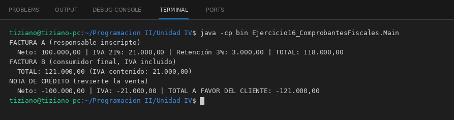

# ComprobanteFiscal

Programación II - Unidad 4 - Ejercicio 16

## Consigna
Emitir distintos comprobantes fiscales a partir de un mismo monto neto.

## Lógica
- Interfaz `ComprobanteFiscal` con `void emitirComprobante(double montoNeto)`.
- `FacturaA` suma 21 % de IVA y resta 3 % de retención, `FacturaB` muestra el total con IVA incluido y `NotaCredito` revierte la venta con importes negativos.
- `CajaRegistradora` guarda una lista de comprobantes y emite todos sobre el mismo monto (valida que sea positivo).
- `Main`: emite los tres comprobantes sobre una venta de 100 000.

## Ejecución

